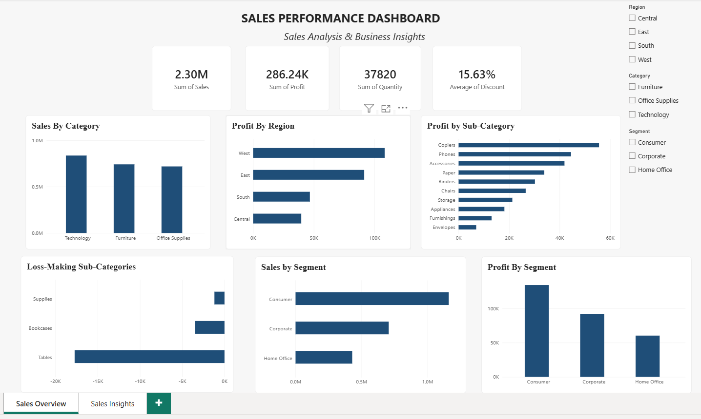
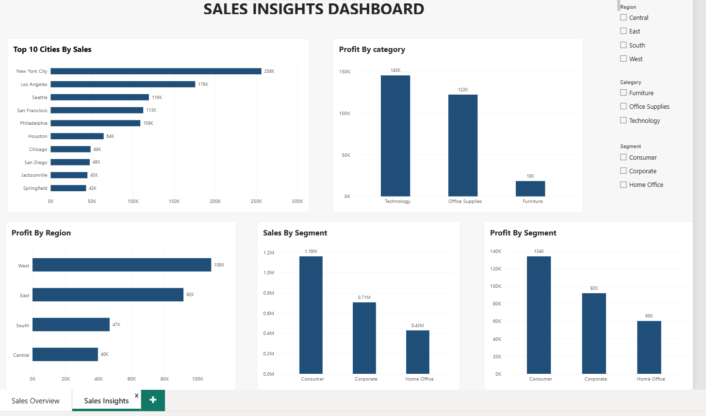

# Sales Performance Analysis

## Project Overview
An end-to-end Sales Performance Analysis project using Python, SQL Server, and Power BI. This project focuses on cleaning sales data, performing data analysis, identifying business trends, and presenting actionable insights through interactive dashboards.

## Tools & Technologies
- **Python:** Pandas, NumPy, Matplotlib
- **SQL:** SQL Server
- **Data Visualization:** Power BI
- **Dataset:** Sample Superstore

## Project Workflow
1. Imported and explored the sales dataset.
2. Cleaned the data using Python and removed duplicate records.
3. Performed exploratory data analysis (EDA).
4. Imported cleaned data into SQL Server.
5. Executed SQL queries to analyze sales, profit, regions, categories, and customer segments.
6. Created interactive Power BI dashboards with KPIs, charts, and slicers.

## Key Business Metrics

| Metric | Result |
|---|---:|
| Total Records | 9,977 |
| Total Sales | 2,296,195.59 |
| Total Profit | 286,241.42 |
| Total Quantity | 37,820 |
| Average Discount | 15.63% |

## Key Insights
- Technology generated the highest category profit.
- The West region recorded the highest regional profit.
- Consumer segment contributed the highest sales and profit.
- Tables, Bookcases, and Supplies were loss-making sub-categories.
- Copiers generated the highest profit among sub-categories.

## Power BI Dashboard
The project includes two dashboard pages:
- **Sales Overview:** KPIs, category sales, regional profit, sub-category profit, and segment analysis.
- 
- **Sales Insights:** Top 10 cities by sales, category profit, regional profit, and segment performance.
- 

## Project Files
- `Sales_Analysis.ipynb` – Python data cleaning and analysis.
- `Sales_Cleaned.csv` – Cleaned sales dataset.
- `Sales_Analysis.sql` – Main SQL analysis queries.
- `Additional_Sales_Analysis.sql` – Additional SQL analysis queries.
- `Database_Check.sql` – Database verification queries.
- `Sales_Performance_Analysis.pbix` – Interactive Power BI dashboard.
- `Sales_Performance_Analysis_Final_Report (1).pdf` – Final project report.

  
## Conclusion
This project demonstrates practical skills in data cleaning, exploratory data analysis, SQL querying, data visualization, and business insight generation.

**Author:** Arti1813
